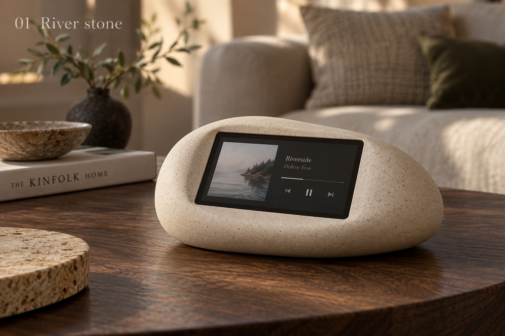

# iPhone 11 / original 01 River Stone

Updated 10 October 2026 from the user’s 28 September handover and confirmed print result. Active hardware: **iPhone 11 + UGREEN 25683 power bank**. Waveshare remains [parked fallback](../fallback-waveshare.md). Physical design only; no app or firmware changes in this work.

## Current baseline

| Item | Current state |
|---|---|
| Body fit | **snug-frame-0p20 physically passed**, 0.20 mm per side |
| Aperture bounds | **138.9 × 63.7 mm**, 6 mm overlap, straight edges passed |
| Aperture corners | **R6.5 derived correction**; printed R3 exposed inactive corners |
| Bank | **UGREEN 25683**, 147 × 72 × 28 mm; model confirmed by supplied handover |
| Recess | Unselected; 1.2 mm lip with 0.4 / 0.8 mm spacers gives 1.6 / 2.0 mm |
| Microphones | Must remain unobstructed; mounted acoustic performance untested |

The earlier R3 paper pass is superseded by the later printed corner observation. R6.5 follows a circular approximation to the display corner, not an Apple mechanical drawing. The source assumes centred display registration. Manufacturing/fit play and display offset can consume the calculated margin; do not treat the handover’s 0.2 mm offset analysis as a complete tolerance stack. No repeated body-fit print is required, but corner concealment must still be observed on the eventual enclosure.

## Files and provenance

- [Printed v3 source models](sample-v3/README.md): original R3 STL/STEP and imported validation, preserved as history.
- [Corrected v3r1](sample-v3r1/README.md): R6.5 opening, same passed 0p20 body wall; unprinted revision.
- [Compact packaging study](compact-layout-v1/README.md): candidate bounds, STEP volumes and clearance report.
- [Paper aperture](mask-trial.svg), [interface section](interface-section.svg) and [earlier planning layout](mounting-layout.svg).
- [Supplied handover](handover-2026-09-28.md): historical source; its request to confirm the printed variant is resolved by the supplied README and user clarification.

The community iPhone STEP is not Apple-certified. Its SHA-256 was independently checked against the handover: ab204f6316407f9c7d9d6a7ec7a97fdd5a2abde12e56e619c3cbceff6474a561. Source URL and imported measurements are in sample-v3/iphone11-reference-check.json. The phone STEP is not redistributed. Imported validation is distinguished from checks run on the new revision.

## Fit and protected spaces

Use the passed snug outline on the body, with generous non-contact relief around hidden features. Do not require precise physical button or camera measurements merely to reproduce the community geometry.

| Feature | Design reservation |
|---|---|
| Camera | 31.1 × 34.3 mm footprint; 5 mm behind back glass; no contact |
| Buttons | Span plus 3 mm each end; at least 3 mm from enclosure material |
| Lightning/grilles | 52.8 mm end opening; plug and cable envelope still adjustable |
| Top/earpiece end | 36 mm opening; acoustic performance not established by its width |
| Perimeter | Passed 0.20 mm snug-fit allowance, outside relief zones |

Mount from behind/underneath. No force on active glass, camera or phone battery; future keeper screws must close on cradle hard stops. Keep rear camera microphone, front/notch inlet and connector-end openings clear, with short open routes to room air. Interrupt any light-seal gasket at the acoustic paths. Openings must remain above table contact level. An open sample does not establish the performance of the eventual closed stone.

The supplied v3 coordinates put the top end at local +X, unlike the earlier screen-front convention. The compact study explicitly rotates it to notch-left / Lightning-right. Do not mix coordinate conventions when adding reliefs.

## Bank and cable

Use the UGREEN 25683 intact in a separate serviceable restraint. The handover reports 435 g ±5 g, two USB-A outputs and one USB-C bidirectional port; these are supplied manufacturer-reference data, not measurements repeated here. Keep a heat escape path and separation from the phone. Charging behaviour, runtime, temperature and any concurrent charging/output remain untested.

Route the lead behind the phone after its plug exits. The old 25 mm per-end allocations are historical guesses, not design requirements. The compact study exposes an adjustable plug-length parameter and clearly labelled cable-turn/bank-port boxes. Required before final cable-channel geometry: Lightning plug length/width/thickness, cable diameter/bend requirement and actual bank port position. No selected cable or native Fusion design is claimed.

## Next physical work

Complete the compact curved shell and service/retention details using original 01, then verify aperture registration and microphone pickup with the enclosure assembled. Preserve the body-fit pass; do not repeat that trial just to change corner masking. Retention, touch at the final recess, thermal behaviour and mounted microphone recordings remain open.
