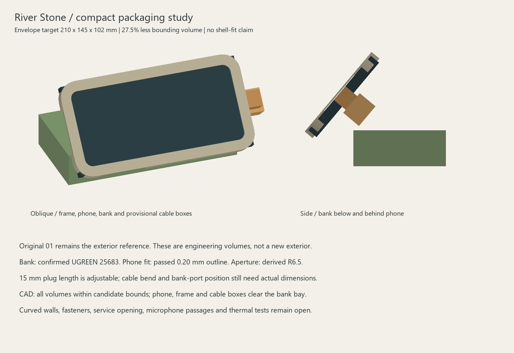

# Compact packaging study v1

10 October 2026. This study reduces the planning envelope while preserving the original 01 River Stone exterior brief. It is **not a finished curved enclosure, printable shell or native Fusion file**.

[Old/new bounds overlay](bounds-overlay.svg) · [Multi-part STEP](packaging-study.step) · [Clearance report](validation.json)

| Dimension | Previous planning bounds | Candidate |
|---|---:|---:|
| Width | 240 mm | 210 mm |
| Depth | 170 mm | 145 mm |
| Height | 105 mm | 102 mm |

Candidate bounding-box volume is 27.5% lower; this is not a claim about plastic or finished shell volume. The 50-degree phone inclination and existing lower-glass position remain unchanged to isolate the packaging change. Final dimensions depend on the curved wall and cable sweep.

## Arrangement and adjustable spaces

The corrected v3r1 frame is posed around the nominal phone envelope. The source model uses top-end +X; the pose explicitly rotates it so the notch is left and Lightning right when viewed from the front. A 0.4 mm spacer is assumed solely for this layout, not selected as final recess. The confirmed 147 × 72 × 28 mm UGREEN 25683 sits low behind the phone, inside a 151 × 76 × 32 mm service bay.

A 5 mm reserve behind the entire phone conservatively covers the local camera keep-out; it is not the measured camera projection. The sample wall is a positioning reference, not final retention. Neither phone nor battery is clamped in this study.

The phone plug box assumes **15 mm length, 14 mm width, 12 mm height**; its adjacent turn box is **23 × 20 × 16 mm**, directing space behind the phone. These deliberately visible assumptions do not identify a cable or guarantee its bend radius. Use --plug-length to explore a different length. A 20 mm reservation along one whole bank end stands in for unknown bank-port location. No 25 mm per-end phone allowance is being treated as a requirement.

## Executed checks and limits

All component/reservation solids fit inside the candidate rectangular envelope. Phone, corrected frame, conservative rear reserve, plug and cable-turn boxes have zero intersection volume with the bank bay. JSON records actual Boolean results. These are component-to-box checks; rounded pebble walls may still intrude near the corners. The candidate box is intentionally not exported as an enclosure.

No curved-shell clearance, fastener access, insertion sweep, actual cable continuity, thermal behaviour or acoustic transparency is established. The service design may still require removing the bank before the phone. Production microphone paths must connect the protected zones to room air above the table contact plane, preserving the user's no-obstruction requirement.

Next CAD step: shape the original 01 curved body around these volumes, add rear-loading retention and underside service access, and test wall clearance. Before fixing the cable channel, obtain the actual Lightning plug length/width/thickness, cable diameter/bend requirement and bank port position. No repeat snug-fit print is needed.

Reproduce with tools/iphone_compact_layout.py --deps <CadQuery directory> [--plug-length 15], then tools/render_iphone_compact_layout.py. All output is a study, not production geometry.
